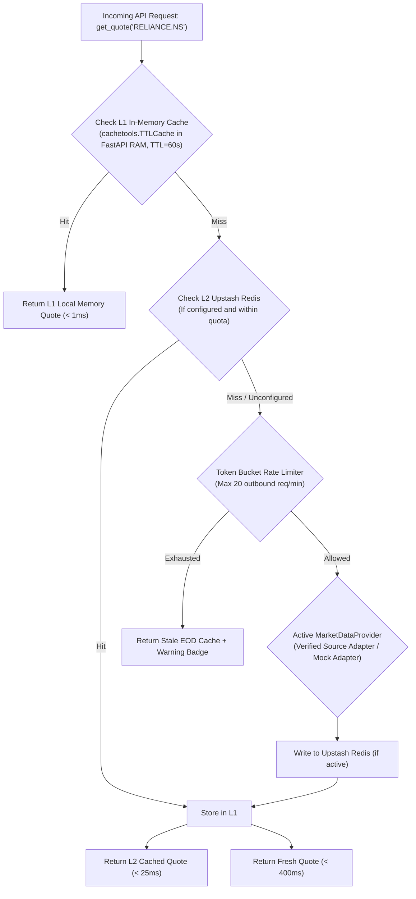
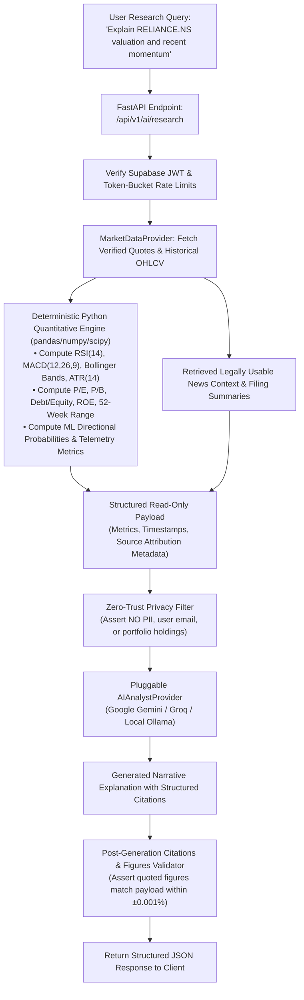
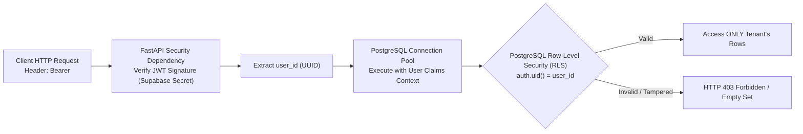

# MarketPulse: System Architecture Specification

**Document Version**: 1.0  
**Status**: PROPOSED SYSTEM ARCHITECTURE SPECIFICATION  
**Author / Team**: MarketPulse Core Quantitative & Engineering Team  
**Workspace Path**: `docs/architecture.md`  
**Preservation Rule**: Existing live application (`app.py`, `Stock_market.ipynb`) and both model artifacts (`final_stock_model.joblib` - 731 MB, `final_stock_model_50trees.joblib` - 38.5 MB) remain permanently untouched in the workspace root as historical baselines.

---

## 1. Executive Summary & Architectural Principles

This document defines the system architecture for **MarketPulse**, an AI-powered financial research and decision-support SaaS targeting Indian (NSE/BSE) and US (NYSE/NASDAQ) equities.

```mermaid
flowchart TD
    subgraph Client_Edge ["Client & Edge Delivery"]
        UserBrowser["Web Browser (Desktop / Mobile)"]
        EdgeCDN["Cloudflare Pages / Vercel Edge<br/>Next.js Static Export / Client-Side Fetching"]
    end

    subgraph API_Compute ["Backend & Compute Layer (Render Staging / Prototype Tier)"]
        FastAPI_GW["FastAPI Service (Python 3.11, Async)<br/>Uvicorn Gateway + CORS + Rate Limiter"]
        Auth_Middleware["JWT Auth & Tenant Isolation Middleware"]
        Router_Market["Market Data & Technicals Router"]
        Router_AI["AI Analyst Router (Grounded Citations)"]
        Router_Backtest["Walk-Forward Backtesting Engine"]
        Router_Portfolio["Portfolio Risk & Watchlists Router"]
        ML_Runtime["Inference Engine (Rule-Based Factors / Future LightGBM)"]
    end

    subgraph Data_Cache ["Persistence & Caching Layer (Free Tiers)"]
        UpstashRedis["Upstash Serverless Redis (Re-verify limits)<br/>L2 Ephemeral Cache + Rate Limiting"]
        SupabasePostgres["Supabase PostgreSQL 15<br/>User Accounts, Portfolios, Watchlists, RLS Enabled"]
    end

    subgraph External_Services ["External Data & AI Services"]
        AI_Provider["Pluggable AIAnalystProvider<br/>(Model-Independent Protocol / Ollama Compatible)"]
        MarketProxy["Replaceable MarketDataProvider<br/>(Verified Data Adapter or Explicit Unavailable Label)"]
    end

    UserBrowser <-->|HTTPS / WSS| EdgeCDN
    EdgeCDN <-->|REST API / JSON| FastAPI_GW
    FastAPI_GW --> Auth_Middleware
    Auth_Middleware --> Router_Market
    Auth_Middleware --> Router_AI
    Auth_Middleware --> Router_Backtest
    Auth_Middleware --> Router_Portfolio

    Router_Market <-->|Check Cache (L2)| UpstashRedis
    Router_Market <-->|Cache Miss| MarketProxy
    Router_Portfolio <-->|Encrypted Tenant Data| SupabasePostgres
    Router_AI <-->|Grounded Synthesis| AI_Provider
    Router_Market --> ML_Runtime
    Router_Backtest --> Router_Market
```

### Core Design Principles
1. **Decoupled Client-Server Isolation**: The frontend is a static/client-side React application hosted on Cloudflare Pages or Vercel; the backend is a stateless, asynchronous Python REST API.
2. **Strict Zero-Trust Tenancy**: Data isolation is enforced at the database layer using PostgreSQL Row-Level Security (RLS) linked to cryptographically signed JWT tokens.
3. **Pluggable Data Providers with Strict Availability Policy**: Market data is accessed strictly through an abstract interface (`MarketDataProvider`). If a data source does not have verified commercial/redistribution permissions, data must be labeled as `[Unavailable - Verification Required]` rather than serving unauthorized scrapes in production.
4. **₹0/Month Staging Target vs. Production Reality**: Initial staging and testing target ₹0/month. However, production-grade 24/7 global SaaS availability, unthrottled market data, and SLA-backed uptime will require transitioning to paid infrastructure and licensed feeds.
5. **Non-Disruptive Staging Isolation**: The existing live Streamlit app and historical baseline models remain 100% untouched. The live Streamlit app remains the active production deployment until the new architecture passes all acceptance tests in staging.
6. **LLM Grounding & Deterministic Separation**: Financial research synthesis strictly enforces separation between deterministic calculations (pre-computed by backend Python quantitative engines) and narrative explanation. The LLM must never invent prices, metrics, citations, or prediction outputs. Zero credentials, user PII, or confidential portfolio holdings are transmitted.

---

## 2. Component Selection, Trade-Offs & Rationale

| Layer | Selected Technology | Alternative Evaluated | Why Selected | Trade-Offs & Next.js Static Export Implications |
| :--- | :--- | :--- | :--- | :--- |
| **Frontend Framework & Hosting** | **Next.js 14+ on Cloudflare Pages (Recommended for Public SaaS)** | Vite + React SPA, Vercel Hobby (Prototyping Only) | Next.js offers component modularity, TypeScript safety, and TradingView charts. Cloudflare Pages allows **100% free commercial usage with unlimited bandwidth**, eliminating Vercel Hobby's non-commercial legal restriction. | **Next.js Static Export Limitations (`output: 'export'`)**:<br>1. *No Server-Side API Routes*: `/app/api/*` routes inside Next.js are disabled; all backend endpoints must live independently on FastAPI.<br>2. *No Request-Time SSR*: `getServerSideProps`, `cookies()`, and `headers()` at render time are disabled.<br>3. *No Request-Time ISR*: Dynamic incremental revalidation at the CDN edge is unavailable.<br>4. *Image Optimization*: Default Next.js Image Optimization service is disabled; requires `images: { unoptimized: true }` or Cloudflare Image Resizing.<br>5. *Dynamic Routing*: Routes like `/stock/[symbol]` must use client-side navigation (`useParams` / TanStack Query) or pre-render common Nifty 50 tickers via `generateStaticParams()`. |
| **Charting Engine** | **TradingView Lightweight Charts** | Plotly, Chart.js, Recharts | Built specifically for financial candlestick series; renders at 60 FPS on Canvas/WebGL with sub-millisecond redraws. | Less general-purpose than Plotly; canvas requires careful unmount cleanup in React to prevent browser memory leaks. |
| **Backend API Runtime** | **FastAPI (Python 3.11) on Render Free (Staging Only)** | Express.js, Django, Fly.io | High async performance via Starlette/Pydantic v2; direct access to Python quantitative libraries (`pandas`, `numpy`). | **Staging/Prototype Only**: Render Free spins down after 15 min idle (30–50s cold start) and has 750 free hours/mo. Not guaranteed production-grade 24/7 hosting. |
| **Database & Auth** | **Supabase (PostgreSQL 15 + Supabase Auth)** | Firebase, Neon, AWS RDS | Unified Postgres database with built-in JWT Auth, Row-Level Security (RLS), and 50,000 monthly active users for free. | Inactive projects pause after 7 days without queries. **No artificial keep-alive bypasses permitted**. Expected pausing and dashboard recovery must be documented. |
| **Caching Layer** | **Upstash Serverless Redis (with Local RAM Fallback)** | Redis Cloud, In-Memory Dict | Serverless Redis accessible via REST/TCP; token-bucket rate limiting. | **Current Official Quotas**: 500,000 commands/month and 256 MB storage (subject to re-verification when setup occurs). Free-to-paid transition occurs if monthly traffic exceeds 500k commands (~16,666 commands/day). **Mandatory Fallback**: In-process `LocalMemoryCache` (`cachetools.TTLCache`) inside FastAPI to run without Upstash dependency. |
| **AI Inference** | **Pluggable `AIAnalystProvider` (Model-Independent Protocol)** | Dedicated Self-Hosted Models | Abstract interface isolating backend from specific LLM providers. Evaluates currently available models (e.g. Google Gemini 3.5 Flash-Lite / Gemini 3.8 Flash or Groq Llama 3.1) after verification during setup. | **Model Independence & Privacy**: Gemini 1.5 Flash is not treated as a verified choice (superseded in official guidance for new projects). Model selection remains explicitly unresolved until verified during Phase 3 setup. Free-tier Google AI Studio terms log data for model training; **strict rule: Never transmit user PII, account data, or confidential portfolio amounts to any external LLM.** Send only public market symbols, calculated technical ratios, and public news headlines. |
| **ML Inference** | **Rule-Based Factors (MVP) $\rightarrow$ Separate LightGBM Milestone** | Scikit-learn Random Forest (Current) | Clean factor scorecards (Value, Momentum, Quality, Volatility) for MVP. | **Safer Sequence**: Build and test base API, data pipeline, and charts first. Any LightGBM model training or replacement is deferred to a **separately approved future milestone**. |

---

## 3. Multi-Region Equities Architecture (India & US)

### 3.1 Unified Ticker Symbol Convention
To support both Indian and US markets cleanly across APIs, databases, and caches, MarketPulse enforces a standard ISO-compatible ticker naming standard:

| Market | Primary Exchange | Suffix Convention | Examples | Base Currency | Numbering Format |
| :--- | :--- | :--- | :--- | :--- | :--- |
| **India** | National Stock Exchange (NSE) | `.NS` | `RELIANCE.NS`, `INFY.NS`, `HDFCBANK.NS` | INR (₹) | Lakhs / Crores (e.g. ₹12.50 Cr) |
| **India** | Bombay Stock Exchange (BSE) | `.BO` | `RELIANCE.BO`, `TCS.BO`, `SBIN.BO` | INR (₹) | Lakhs / Crores |
| **United States** | NASDAQ | None | `AAPL`, `MSFT`, `NVDA`, `TSLA` | USD ($) | Millions / Billions (e.g. $2.85B) |
| **United States** | NYSE | None | `BRK.A`, `JPM`, `V`, `WMT` | USD ($) | Millions / Billions |

### 3.2 Market Session & Timezone Engine
The backend implements a deterministic market schedule state machine to optimize caching and prevent unnecessary API hammering:

```
[ Market State Machine ]
  ├── PRE_MARKET   (NSE: 09:00 - 09:15 IST | US: 04:00 - 09:30 EST) -> Refresh quote cache every 5 min
  ├── REGULAR      (NSE: 09:15 - 15:30 IST | US: 09:30 - 16:00 EST) -> 15-minute quote TTL
  ├── POST_MARKET  (NSE: 15:30 - 16:00 IST | US: 16:00 - 20:00 EST) -> Fetch closing prices
  ├── CLOSED       (Evenings / Weekends)                             -> 24-hour immutable EOD cache
  └── HOLIDAY      (Official Exchange Holidays)                     -> 24-hour immutable EOD cache
```

* **Indian Calendar**: Built-in verification against official NSE trading holidays (Republic Day, Mahashivratri, Holi, Diwali, etc.).
* **US Calendar**: Built-in verification against NYSE/NASDAQ trading holidays (New Year's Day, MLK Day, Memorial Day, Juneteenth, Independence Day, Thanksgiving, Christmas).

---

## 4. Replaceable Market Data Provider Interface (`MarketDataProvider`)

### 4.1 Interface Specification
To prevent hard vendor lock-in and enable zero-downtime provider swaps, all market data operations must conform to this abstract Python protocol:

```python
from abc import ABC, abstractmethod
from typing import List, Optional
from datetime import datetime
import pandas as pd
from pydantic import BaseModel

class QuoteData(BaseModel):
    symbol: str
    exchange: str
    currency: str
    price: float
    change: float
    change_percent: float
    open: float
    high: float
    low: float
    previous_close: float
    volume: int
    timestamp: datetime
    is_delayed: bool
    source_attribution: str

class SymbolSearchResult(BaseModel):
    symbol: str
    name: str
    exchange: str
    currency: str
    type: str  # Equity, ETF, Index

class MarketDataProvider(ABC):
    """Abstract pluggable interface for all MarketPulse data ingestion."""

    @abstractmethod
    async def get_quote(self, symbol: str) -> QuoteData:
        """Fetch current or latest completed market quote."""
        pass

    @abstractmethod
    async def get_historical_ohlcv(
        self, symbol: str, timeframe: str = "1d", lookback_days: int = 365
    ) -> pd.DataFrame:
        """Fetch historical dataframe with columns: [timestamp, open, high, low, close, volume]."""
        pass

    @abstractmethod
    async def search_symbols(self, query: str) -> List[SymbolSearchResult]:
        """Perform symbol autocomplete across supported exchanges."""
        pass

    @abstractmethod
    async def get_fundamentals(self, symbol: str) -> dict:
        """Fetch financial valuation ratios (P/E, Market Cap, Dividend Yield)."""
        pass
```

### 4.2 Multi-Layer Caching & Rate-Limiting Strategy



### 4.3 Data Licensing & Public SaaS Launch Blocker Policy
1. **Public SaaS Launch Blocker**: **A public SaaS launch is strictly BLOCKED until a market-data provider legally authorizes the intended India and US data usage.**
2. **Initial Development & Staging Feeds**:
   * Initial development and local testing will strictly rely on:
     - `MockMarketDataProvider`: Deterministic, synthetic market data generator for unit and integration testing.
     - `AuthorizedCSVDataProvider`: Historical CSV data loaders utilizing authorized public historical data (such as the existing historical datasets in `data/`).
3. **No False Promises of Live Data**:
   * The platform will **not** promise or display live market data to users until coverage, commercial redistribution rights, and licensing terms are verified and confirmed.
   * If a market or ticker does not have a confirmed, licensed provider adapter configured, the system must explicitly display:
     `[Market Data Unavailable - Verified Provider Required]`
     preventing any unauthorized web-scraping or ungrounded mock figures from masquerading as live exchange feeds.
4. **Strict No-Paid-Upgrade Rule**: No commercial provider (e.g., Upstox, Polygon, TrueData) will be configured with a paid billing account without explicit user confirmation.

---

## 5. LLM-Powered Financial Research Assistant Architecture (`AIAnalystProvider`)

### 5.1 System Flow & Strict Deterministic Separation
To ensure absolute quantitative accuracy and eliminate hallucinations, MarketPulse strictly decouples deterministic financial calculations from LLM narrative synthesis:



### 5.2 Architectural Rules & Governance for the Research Assistant
1. **Scope Boundaries**: Users can ask natural-language research questions about Indian (NSE/BSE) and US (NYSE/NASDAQ) equities exclusively where verified data is actively available. Unverified tickers return an explicit uncertainty declaration: `[Market Data Unavailable - Verified Provider Required]`.
2. **Grounded Synthesis & Structured Citations**:
   - Every sentence asserting a numerical figure, trend, or corporate fact must include an inline citation tag (e.g., `[Source: NSE Real-Time Feed | Timestamp: 2026-10-23 15:25 IST]`, `[Source: Q2 FY25 Filing]`).
   - The response includes a structured `citations: List[Citation]` array with source name, retrieval timestamp, and verification status.
3. **Strict Separation of Deterministic Math & ML Predictions from LLM Explanations**:
   - The LLM must **never calculate, compute, estimate, or invent stock prices, technical indicators, financial ratios, citations, or machine learning prediction results**.
   - All financial ratios (P/E, P/B, Debt/Equity, ROE), technical indicators (RSI, MACD, Bollinger Bands), risk metrics (Beta, VaR, Drawdown), and ML probabilities are computed deterministically by backend Python quantitative engines (`pandas`, `numpy`, `scipy`) prior to LLM invocation.
   - The LLM serves strictly as an explainability and narrative synthesis layer, interpreting the verified quantitative payload provided by the backend without hallucinating or modifying numerical values.
4. **Handling Missing / Stale Data & Analytical Uncertainty**:
   - If required market data, news sources, or financial metrics are unavailable or unverified for a requested ticker, the assistant must explicitly declare the data as unavailable (e.g., `"P/E ratio is unavailable for this ticker from verified providers"`) and explain the analytical uncertainty rather than guessing or interpolating figures.
   - If quote data timestamp is stale ($> 15$ minutes old during market trading hours), the assistant displays a prominent staleness warning badge (`is_delayed: true` / `stale: true`).
5. **Replaceable `AIAnalystProvider` Protocol & Local Ollama Compatibility**:
   - The LLM engine operates behind an abstract Python interface:
     ```python
     class Citation(BaseModel):
         source: str
         timestamp: datetime
         metric_name: Optional[str] = None
         value: Optional[float] = None

     class ResearchBriefResponse(BaseModel):
         symbol: str
         executive_summary: str
         factor_analysis: str
         risk_considerations: str
         citations: List[Citation]
         uncertainty_notes: List[str]
         data_timestamp: datetime
         provider_metadata: dict

     class AIAnalystProvider(ABC):
         @abstractmethod
         async def generate_research_brief(
             self,
             symbol: str,
             quote: QuoteData,
             deterministic_metrics: dict,
             news_headlines: List[dict]
         ) -> ResearchBriefResponse:
             """Synthesizes grounded research brief without performing math or inventing metrics."""
             pass
     ```
   - Cloud providers (Google AI Studio, Groq) and local self-hosted engines (`OllamaProvider` running Llama 3 / Mistral) implement this identical interface.
   - The active model choice remains explicitly unresolved until verified during Phase 3 setup; Gemini 1.5 Flash is not treated as verified (superseded in official docs for new projects).
6. **Zero-Trust Privacy & Confidentiality Guardrails**:
   - Under no circumstances shall user credentials, account UUIDs, user personal identifiable information (PII), email addresses, or confidential portfolio holdings/balances be transmitted to an external LLM provider without an approved, verified privacy design.
   - Outbound prompts are restricted exclusively to public ticker symbols, pre-computed technical/fundamental metrics, and public news headlines.
7. **Commercial Availability & Free-Tier Disclaimers**:
   - Free-tier cloud LLM quotas (Google AI Studio, Groq) do NOT guarantee 24/7 production availability, low latency, or zero-cost commercial redistribution rights. Production deployment requires explicit budget allocation for paid API tokens.

---

## 6. Security, Privacy & User Tenancy Isolation



### 6.1 Database Schema & Row-Level Security (RLS)
The PostgreSQL schema enforces zero-trust data segregation at the database level:

```sql
-- Profiles table linked to Supabase Auth
CREATE TABLE public.profiles (
    id UUID PRIMARY KEY REFERENCES auth.users(id) ON DELETE CASCADE,
    email TEXT NOT NULL,
    created_at TIMESTAMPTZ DEFAULT NOW()
);

-- Watchlists table with RLS
CREATE TABLE public.watchlists (
    id UUID PRIMARY KEY DEFAULT gen_random_uuid(),
    user_id UUID NOT NULL REFERENCES auth.users(id) ON DELETE CASCADE,
    name TEXT NOT NULL,
    created_at TIMESTAMPTZ DEFAULT NOW()
);
ALTER TABLE public.watchlists ENABLE ROW LEVEL SECURITY;
CREATE POLICY "Users can only access their own watchlists"
    ON public.watchlists FOR ALL
    USING (auth.uid() = user_id);

-- Portfolios table with RLS
CREATE TABLE public.portfolio_holdings (
    id UUID PRIMARY KEY DEFAULT gen_random_uuid(),
    user_id UUID NOT NULL REFERENCES auth.users(id) ON DELETE CASCADE,
    symbol TEXT NOT NULL,
    quantity NUMERIC NOT NULL CHECK (quantity > 0),
    buy_price NUMERIC NOT NULL CHECK (buy_price >= 0),
    buy_date DATE NOT NULL,
    created_at TIMESTAMPTZ DEFAULT NOW()
);
ALTER TABLE public.portfolio_holdings ENABLE ROW LEVEL SECURITY;
CREATE POLICY "Users can only access their own portfolio holdings"
    ON public.portfolio_holdings FOR ALL
    USING (auth.uid() = user_id);
```

### 6.2 Network & Application Security
* **CORS Whitelist**: Strictly restricted to the production frontend domain (`https://marketpulse.app`) and staging preview domains (`https://*.pages.dev`). Wildcard `*` origins and credentials combinations are prohibited.
* **Content Security Policy (CSP)**: Headers enforced via Next.js middleware preventing cross-site scripting (XSS) and iframe clickjacking.
* **Zero Secrets in Code**: All API keys (Supabase Service Key, AI Provider Key, Upstash Redis URL) are injected via cloud environment variables.

---

## 7. Free-First Cloud Deployment Plan (₹0/Month Staging Budget)

### 7.1 Cloud Service Map & Quota Bounds

```
[ Free-First Cloud Deployment Map (Staging & Prototype) ]
Frontend: Cloudflare Pages (Recommended for Public SaaS: 100% Free for commercial static export, unlimited bandwidth)
Backend API: Render Free Web Service (STAGING / PROTOTYPE RUNTIME ONLY: 512 MB RAM, 0.1 vCPU, 750 free hrs/mo, 15m idle spin-down)
Database & Auth: Supabase Free Tier (500 MB Postgres storage, 50,000 monthly active users, pauses after 7 days, no artificial keep-alives)
Caching & Rate Limiting: Upstash Serverless Redis (Current official free quota: 500,000 commands/month, 256 MB storage; local RAM L1 fallback)
AI Reasoning: Pluggable AIAnalystProvider (Model-Independent Protocol; Google AI Studio / Groq free tier; local Ollama compatible)
Initial Staging Target Cost: Exactly ₹0.00 / month
```

### 7.2 Target ₹0 Staging Budget vs. Audited Production-Grade Global SaaS Reality
While MarketPulse is strictly budgeted at **hard ₹0/month during initial development, staging, and evaluation**, a reliable, public, commercial-grade SaaS with global multi-user availability cannot operate perpetually on free tiers.

The table below reconciles all cost estimates with official pricing sources and transparent calculations:

| Category / Layer | Staging / Free-Tier Limit | Transition Trigger to Paid | Production-Grade Paid Service | Official Source / Basis of Calculation | Expected Production Cost (USD / INR) |
| :--- | :--- | :--- | :--- | :--- | :--- |
| **CATEGORY A: VERIFIED CURRENT FIXED INFRASTRUCTURE** | | | | | |
| **Frontend CDN & Edge Hosting** | **Cloudflare Pages Free Tier**<br>• Unlimited bandwidth<br>• Unlimited requests<br>• Static export (`output: 'export'`) | Requirement for dynamic edge server-side rendering (SSR) or edge middleware exceeding static export capabilities | **Cloudflare Pages Paid / Workers** ($5/mo) or **Vercel Pro** ($20/seat/mo) | Official Cloudflare pricing: Pages is 100% free with unlimited bandwidth for commercial static hosting. Vercel Pro is $20/month per team seat. | **$0.00 / month** on Cloudflare Pages<br>*(or $20.00/mo [~₹1,660/mo] if Vercel Pro is selected)* |
| **Backend API Runtime** | **Render Free Web Service**<br>• 512 MB RAM, 0.1 vCPU<br>• 750 free instance hours/mo<br>• 15-min idle spin-down | Production launch requiring guaranteed 24/7 uptime without 30–50s cold-start latencies | **Render Starter Web Service**<br>(Always-on, 0.5 CPU, 512 MB RAM) or **Fly.io dedicated container** | Official Render pricing page: Starter Web Service is flat $7.00/month. Calculation: $7.00 × ₹83.00/USD ≈ ₹581/mo. | **$7.00 / month**<br>(~₹581 / month) |
| **Database & Authentication** | **Supabase Free Tier**<br>• 500 MB Postgres storage<br>• 50,000 MAU<br>• Inactivity pause after 7 days | Relational storage $> 500\text{ MB}$, automated PITR backups required, or zero-pause SLA needed | **Supabase Pro Tier**<br>(8 GB Postgres storage, 100k MAU, 7-day PITR, no pausing) | Official Supabase pricing page: Pro Tier is flat $25.00/month. Calculation: $25.00 × ₹83.00/USD ≈ ₹2,075/mo. | **$25.00 / month**<br>(~₹2,075 / month) |
| **CATEGORY B: USAGE-BASED VARIABLE ESTIMATES** | | | | | |
| **In-Memory Caching & Rate Limiting** | **Upstash Redis Free Tier**<br>• 500,000 commands/month<br>• 256 MB storage<br>• Local RAM L1 fallback | Cache queries exceed 500,000 monthly commands (~16,666 commands/day) | **Upstash Pay-As-You-Go**<br>($0.20 per 100,000 commands above free allowance) | Official Upstash pricing: $0.20 per 100k commands. Calculation: If within 500k/mo = $0.00. If traffic reaches 1,000,000–2,000,000 commands/mo = $2.00–$4.00/mo. | **$0.00 – $4.00 / month**<br>(₹0 – ₹332 / month) |
| **AI Synthesis & Research** | **Google AI Studio Free Tier**<br>• Pluggable Provider (`gemini-3.5-flash-lite` or verified equiv.)<br>• Public data only | Request volume exceeds free rate limits or commercial zero-logging terms required | **Google Cloud Gemini API Paid Standard Tier**<br>($0.30 / 1M input tokens, $2.50 / 1M output tokens for 3.5 Flash-Lite) | Official Google AI pricing: At 1,000 research queries/day (30,000 queries/mo) with ~1,500 input and ~500 output tokens: 45M input ($13.50) + 15M output ($37.50) = $51.00/mo. Batch/Flex rate is ~$25.50/mo. Free tier is $0.00/mo. | **$0.00 – $51.00 / month**<br>(₹0 – ₹4,233 / month) |
| **CATEGORY C: UNKNOWN COMMERCIAL MARKET-DATA FEES** | | | | | |
| **Market Data Feeds: India (NSE/BSE)** | **Mock Adapter / Local Public CSVs**<br>• `MockMarketDataProvider`<br>• `AuthorizedCSVDataProvider` | Public commercial SaaS launch displaying Indian equity quotes to external subscribers | **Licensed Indian Market Data Provider** (e.g. TrueData, Upstox API, or Direct NSE Data Feed) | **[UNKNOWN - Custom Vendor Quote & Exchange Redistribution Agreement Required]**.<br>Developer personal API tiers (e.g. ₹2,000–₹4,000/mo) strictly prohibit multi-tenant commercial SaaS redistribution. Official commercial redistribution requires exchange licensing agreements with undisclosed enterprise quotes. | **[UNKNOWN]**<br>*(Vendor Quote Required prior to launch)* |
| **Market Data Feeds: US (NYSE/NASDAQ)** | **Mock Adapter / Local Public CSVs**<br>• Synthetic generator<br>• Offline test fixtures | Public commercial SaaS launch displaying US equity quotes to external subscribers | **Licensed US Market Data Provider** (e.g. Polygon.io Business, IEX Cloud, or Intrinio) | **[UNKNOWN - Custom Vendor Quote & Exchange Redistribution Agreement Required]**.<br>Developer tiers ($29–$49/mo) are restricted to personal/internal use. Public SaaS redistribution requires Polygon Enterprise or IEX Business commercial display licensing. | **[UNKNOWN]**<br>*(Vendor Quote Required prior to launch)* |
| **TOTAL BUDGET SUMMARY** | **Staging / Evaluation Phase** | **Commercial SaaS Launch Gate** | **Production-Grade Architecture** | **Audited Cost Summary Breakdown** | **Total Production Cost Range** |
| **1. Staging / Evaluation Environment** | **Hard Cap: Exactly ₹0.00 / month** | N/A | Free-tier staging only | Verified across Render Free, Supabase Free, Cloudflare Pages, Upstash Free, AI Studio Free. | **Exactly ₹0.00 / month** |
| **2. Production Known Infrastructure** | N/A | Post-Validation Commercial Cutover | Paid production-grade services (Verified Fixed + Usage Estimates) | Verified Fixed ($32.00/mo) + Estimated Cache ($0–$4/mo) + Estimated AI ($0–$51/mo). Range: **~$32.00 to ~$87.00 / month (~₹2,650 to ₹7,220 / month)**. *(Add $20/mo if Vercel Pro is used).* | **~$32 – $87 / month**<br>(~₹2,650 – ₹7,220 / month) |
| **3. Market Data Redistribution Licensing** | N/A | Public Commercial SaaS Launch Gate | Licensed Indian & US Exchange Feeds | Exchange redistribution agreements are vendor-quoted. Public commercial SaaS launch remains strictly blocked until quotes are secured. | **[UNKNOWN]**<br>*(Enterprise Quote Required)* |

---

## 8. Staging-to-Production Migration & Preservation Plan

```
[ Isolated Directory Structure ]
D:\MarketPulse\
  ├── app.py                         <-- [PRESERVED LIVE STREAMLIT APP - UNTOUCHED]
  ├── Stock_market.ipynb             <-- [PRESERVED ORIGINAL RESEARCH NOTEBOOK]
  ├── final_stock_model.joblib       <-- [PRESERVED BASELINE MODEL A - 731 MB]
  ├── final_stock_model_50trees.joblib <-- [PRESERVED BASELINE MODEL B - 38.5 MB]
  ├── data/                          <-- [PRESERVED CSV DATASETS]
  ├── docs/                          <-- [PLANNING & ARCHITECTURE DOCS]
  ├── frontend/                      <-- [NEW: Next.js 14+ Web Application]
  ├── backend/                       <-- [NEW: FastAPI REST Application]
  └── models/                        <-- [SEPARATELY APPROVED FUTURE MILESTONE: Compact LightGBM Training & Artifacts]
```

### 8.1 Zero-Risk Deployment Protocol
1. **Preservation Guarantee**: No files in the root repository (`app.py`, `Stock_market.ipynb`, `.joblib` files) will be modified, renamed, or overwritten. Both baseline models (`final_stock_model.joblib` - 731 MB, `final_stock_model_50trees.joblib` - 38.5 MB) remain permanently in the root directory.
2. **Docker Isolation**: The backend `.dockerignore` strictly excludes `*.joblib` from root, preventing memory bloat in staging containers.
3. **Streamlit Production Continuity**: The existing live Streamlit app remains the active production endpoint until the new system passes all end-to-end acceptance tests in staging. The staging environment operates on completely isolated URLs (`https://staging-marketpulse.pages.dev` and `https://marketpulse-api-staging.onrender.com`).
4. **Independent Deployment**: The Next.js frontend (static export on Cloudflare Pages) and FastAPI backend (Render Web Service) are completely decoupled and deployable independently via separate CI/CD pipelines.
5. **LightGBM Milestone Isolation**: Model training, feature store compilation, and artifact replacement are strictly excluded from Phase 3 initial milestones. They will be executed in a dedicated, separately approved future milestone only after the base API, database, and charting UI pass staging validation.

---

## 9. Observability, Monitoring, Backups & Rollback

### 9.1 Health Monitoring & Uptime
* **Health Endpoint**: `/api/v1/health` verifies:
  * Database connectivity (`SELECT 1;`).
  * Redis connectivity (`redis.ping()`).
  * Provider circuit breaker state.
* **Monitoring & Alerts**: UptimeRobot or BetterStack monitors `/api/v1/health` for uptime reporting. **No artificial keep-alive pings are used to bypass third-party inactivity policies.** If Supabase pauses after 7 days of inactivity, the dashboard restore procedure takes ~1–2 minutes without data loss.

### 9.2 Error Tracking & Telemetry
* **Frontend**: Sentry SDK captures React client-side uncaught exceptions and broken render cycles (free tier: 5,000 events/mo).
* **Backend**: Sentry FastAPI middleware logs stack traces with sanitized payloads (passwords, tokens, and PII stripped automatically).

### 9.3 Disaster Recovery & Rollback
* **Frontend Rollback**: Instant one-click rollback on Cloudflare Pages / Vercel to previous immutable deployment commit SHA ($< 5\text{ seconds}$).
* **Backend Rollback**: Docker containers tagged by commit SHA (`marketpulse-api:sha-xyz`). Reverting involves pointing the active container to the prior SHA tag ($< 60\text{ seconds}$).
* **Database Backups**: Supabase provides automated daily database snapshots. Point-in-Time Recovery (PITR) metadata is maintained.

---

## 10. Measurable Architecture Acceptance Criteria

The table below defines the explicit, automated, and measurable acceptance tests required before any staging release is considered valid:

| Acceptance Test Category | Target Criterion & Standard | Exact Measurement & Verification Methodology |
| :--- | :--- | :--- |
| **1. Authentication Security** | • Valid JWT returns HTTP 200 with authenticated user payload.<br>• Expired, revoked, or tampered JWT returns HTTP 401 Unauthorized with descriptive error. | Automated test suite (`pytest`) sends GET request to `/api/v1/user/profile` using: (a) valid Supabase JWT, (b) expired JWT, and (c) forged signature. Assert status codes 200, 401, 401 respectively. |
| **2. Multi-Tenant User Isolation** | 100% tenant segregation across all database operations. Zero cross-tenant data leakage. | Pytest security test provisions two test users (Tenant A and Tenant B). Tenant A attempts to read or mutate Tenant B's watchlist UUID and portfolio holdings. Assert PostgreSQL RLS blocks the request with HTTP 403 Forbidden or empty query result. |
| **3. Data Attribution & Freshness** | All quote and technical data responses must include explicit source attribution and timestamp metadata. Quotes during market hours must have freshness age $\le 15$ minutes or carry `is_delayed: true` flag. | Automated API test validates `/api/v1/market/quote?symbol=RELIANCE.NS` schema. Assert presence of non-empty `source_attribution` field, ISO timestamp, and `is_delayed` boolean. |
| **4. Unavailable Data Handling** | Querying an unverified, unsupported, or unlicensed ticker must return a structured response with status `unavailable` and explicit badge message. No 500 crashes or blank screens. | Pytest calls `/api/v1/market/quote?symbol=UNLICENSED.XYZ`. Assert response is HTTP 200/404 with JSON: `{"status": "unavailable", "badge": "[Market Data Unavailable - Verified Provider Required]"}`. Frontend renders badge cleanly without breaking layout. |
| **5. Rate Limiting & Abuse Prevention** | Outbound requests capped at 20 req/min per client IP/token. Exceeding limit returns HTTP 429 Too Many Requests with `Retry-After` header. | Automated `k6` script fires 25 rapid requests in 10 seconds against `/api/v1/market/quote`. Assert first 20 requests return HTTP 200; requests 21–25 return HTTP 429 with valid `Retry-After` header. |
| **6. Grounded AI Answers & Citations** | 100% of generated research responses cite verified data sources with timestamps; all quoted numerical figures match backend-calculated metrics within $\pm 0.001\%$. | Automated validator calls `/api/v1/ai/research?symbol=RELIANCE.NS`. Compares every numerical claim in narrative against pre-computed factor payload. Assert 100% match and presence of structured citation list. |
| **7. Source Validity & Fake Document Resistance** | Any attempt to elicit citations for non-existent documents, fabricated news, or unverified filings returns explicit refusal. | Automated test prompts AI endpoint requesting analysis of a fabricated merger filing. Assert response returns `"Source not available in verified dataset"`. |
| **8. Missing Evidence & Uncertainty Declaration** | Querying an unverified, illiquid, or delisted equity returns an explicit uncertainty declaration rather than hallucinated metrics. | Pytest queries `/api/v1/ai/research?symbol=UNLICENSED.XYZ`. Assert response contains `"Verified financial data is unavailable for symbol XYZ"` and list of missing metrics. |
| **9. AI Rate Limits & Graceful Provider Fallback** | If the external AI provider returns HTTP 429, 503, or times out ($> 10\text{s}$), the backend gracefully falls back to deterministic factor scorecards with `[AI Synthesis Temporarily Unavailable]`. | Mock failure test injects simulated 429/timeout into `AIAnalystProvider`. Assert client receives HTTP 200 with complete deterministic quantitative metrics and graceful warning badge without UI crash. |
| **10. Zero-Trust Privacy Audit** | Zero user credentials, PII, email addresses, or confidential portfolio amounts are ever transmitted in outbound LLM prompts. | Integration test intercepts outbound HTTP traffic to AI endpoints during simulated user research queries across 50 users. Assert regex scan finds 0 email addresses, user UUIDs, or dollar portfolio holdings. |
| **11. Staging Environment Isolation** | Staging frontend (`staging-marketpulse.pages.dev`) and backend execute full E2E user flow with 0 errors while live Streamlit app remains 100% operational on its independent URL. | Playwright E2E suite runs on staging URL: registers new user, adds ticker to watchlist, renders TradingView chart. Simultaneously, automated health check confirms live Streamlit app responds with HTTP 200. |
| **12. Zero-Downtime Rollback** | In the event of an unexpected regression, frontend and backend roll back to previous stable Git commit SHA in $< 60$ seconds with zero data corruption. | Simulated regression test triggers Cloudflare Pages and Render rollback API. Measure elapsed time to restored healthy `/api/v1/health` response. Assert elapsed time $< 60$ seconds. |
| **13. Performance & Memory Footprint** | P95 cached API latency $< 250\text{ ms}$; P50 cached latency $< 50\text{ ms}$; backend container RAM $< 200\text{ MB}$ under load. | Benchmarked via `k6` load test hitting `/api/v1/market/quote` with warm L1/L2 cache under 50 concurrent simulated users. |
| **14. Staging / Evaluation Financial Compliance** | **Hard Criterion: Exactly ₹0.00 incurred during the staging and evaluation phase.** | Verified across cloud billing consoles (Render, Supabase, Cloudflare, Upstash, Google AI Studio). Any non-zero charge fails staging acceptance. |
| **15. Paid Production Budget Ceiling** | **Target Production Ceiling: ~$32.00 to ~$87.00 / month (~₹2,650 to ₹7,220 / month)** for known infrastructure, plus separately approved market data licensing. | Billing alerts configured at $40/mo and $85/mo. *Explicit Rule: Paid production does NOT cost ₹0.00; ₹0.00 is strictly a hard constraint for the staging/evaluation environment.* |

---

## 11. Summary of Resolved Decisions & Open Decisions for Phase 3

### 11.1 Resolved Architectural Decisions
- [x] **1. Market-Data Dependency & Launch Blocker**: Public SaaS launch is strictly BLOCKED until a provider legally authorizes commercial India and US equity data redistribution. Initial development strictly uses `MockMarketDataProvider` and authorized historical CSVs (`AuthorizedCSVDataProvider`). Unverified tickers must render `[Market Data Unavailable - Verified Provider Required]`.
- [x] **2. Frontend Architecture & Static Export**: Selected **Next.js 14+ on Cloudflare Pages** with `output: 'export'`. Documented that server-side API routes, request-time SSR (`getServerSideProps`), edge ISR, and default image optimization are disabled. Frontend and FastAPI backend are 100% independently deployable.
- [x] **3. Categorized & Audited Cost Structure**: Divided costs into: (A) Verified current fixed infrastructure, (B) Usage-based variable estimates (recalculated with current official Upstash and AI rates), and (C) Unknown commercial market-data licensing. Staging is capped at a hard ₹0.00; production ceiling is explicitly separated at ~$32–$87/mo plus vendor-quoted market data fees.
- [x] **4. LLM-Powered Financial Research Assistant Architecture**: Implemented `AIAnalystProvider` interface with strict deterministic separation: all calculations and ML probabilities are computed by backend Python code; LLM only synthesizes explanations with inline citations and timestamps. Zero user credentials, PII, or portfolio holdings transmitted.
- [x] **5. AI Provider Architecture & Privacy**: Gemini 1.5 Flash is not treated as a verified choice (superseded in official guidance for new projects). Evaluated current models (`gemini-3.5-flash-lite`, `gemini-3.8-flash`) and preserved local Ollama compatibility as an optional future private provider. Provider/model choice is explicitly unresolved and model-independent until live verification during Phase 3 setup.
- [x] **6. Upstash Quota & Local Fallback**: Updated free quota to current official figures: **500,000 commands/month** and 256 MB storage (10,000 commands/day removed). Transition trigger set to $> 500\text{k commands/mo}$. Specified mandatory in-process L1 RAM cache (`cachetools.TTLCache`) inside FastAPI as a local fallback.
- [x] **7. Measurable Acceptance Criteria**: Defined 15 concrete, automated acceptance tests covering authentication, multi-tenant isolation, data attribution/freshness, unavailable data handling, rate limits, grounded AI research, source validity, missing evidence, AI fallback, privacy audit, staging isolation, $< 60$s rollback, hard ₹0.00 staging budget, and separated production budget ceiling.
- [x] **8. Backend Architecture**: Selected **FastAPI (Python 3.11)** on Render Free as a **staging / prototyping runtime only**; existing Streamlit app preserved as active production.
- [x] **9. Database & Auth**: Selected **Supabase (PostgreSQL 15 + Supabase Auth)** with Row-Level Security. No keep-alive pings to bypass 7-day pause policies; documented 1-click restore procedure.
- [x] **10. LightGBM Milestone Isolation**: Model training, feature store generation, and artifact replacement are isolated into a separately approved future milestone. Existing baseline models (`final_stock_model.joblib` - 731 MB, `final_stock_model_50trees.joblib` - 38.5 MB) remain permanently untouched in the root directory.

### 11.2 Open Decisions & Blockers for Phase 3 (Implementation Planning)
The following blockers and decisions remain open before public commercial launch and will be scoped during Phase 3 (Implementation Planning):
1. **Commercial Market Data Licensing Blocker (Public Launch Blocker)**:
   * Public SaaS launch cannot proceed with live market feeds until formal commercial redistribution quotes and exchange agreements are secured for Indian (NSE/BSE) and US (NYSE/NASDAQ) equities.
   * *Phase 3 Action*: Scope Phase 3 implementation strictly around `MockMarketDataProvider` and `AuthorizedCSVDataProvider`, establishing a verified data provider evaluation checklist as a parallel non-blocking research track.
2. **AI Model Selection & Endpoint Verification**:
   * Concrete model binding will be resolved during Phase 3 setup by testing live endpoint availability and quota limits in Google AI Studio (e.g. testing `gemini-3.5-flash-lite` or alternative providers like Groq).
3. **Upstash Live Quota Verification**:
   * Upstash 500,000 commands/month quota and burst limits must be validated directly against upstash.com/pricing during Phase 3 environment configuration.
4. **Staging Hosting Target Confirmation**:
   * Confirm initial staging deployment target: Cloudflare Pages (with static export) vs. Vercel Preview (for non-commercial team evaluation).
5. **LightGBM Benchmark Milestone Scheduling**:
   * Confirm that the LightGBM training script and experiment execution will be isolated into a dedicated milestone scheduled after the base API, database, and charting UI pass staging validation.


