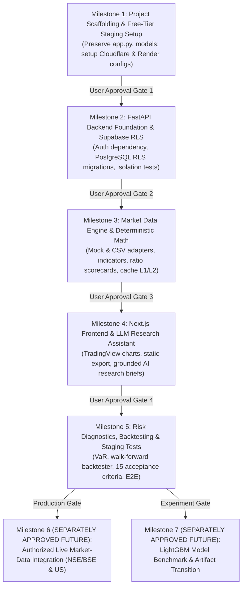

# MarketPulse: Phase 3 Implementation Plan

**Document Version**: 1.0  
**Status**: PROPOSED IMPLEMENTATION PLAN (AWAITING USER APPROVAL)  
**Author / Team**: MarketPulse Core Quantitative & Engineering Team  
**Workspace Path**: `docs/implementation-plan.md`  
**Preservation Rule**: Existing live application (`app.py`, `Stock_market.ipynb`) and both model artifacts (`final_stock_model.joblib` - 731 MB, `final_stock_model_50trees.joblib` - 38.5 MB) remain permanently untouched in the root directory.

---

## 1. Executive Summary & Implementation Governance

This document establishes the sequential, milestone-based implementation roadmap for **MarketPulse**, an AI-powered financial research, factor intelligence, and decision-support SaaS targeting Indian (NSE/BSE) and US (NYSE/NASDAQ) equities.

### 1.1 Core Implementation Principles
1. **Zero-Execution Planning Baseline**: This plan defines architectural sequence and deliverables only. No coding, package installation, model training, deployment, Git commit, or Git push may occur until this document is reviewed and approved, and each milestone is authorized in sequence.
2. **Strict Preservation of Existing Production & Baselines**:
   * The existing live Streamlit application (`app.py`, `Stock_market.ipynb`) remains active and untouched in the root directory.
   * Both baseline model artifacts (`final_stock_model.joblib` - 731 MB and `final_stock_model_50trees.joblib` - 38.5 MB) remain permanently preserved in root.
   * The live Streamlit application remains the active production endpoint until all staging acceptance tests pass and a separate production cutover is explicitly approved.
3. **Hard ₹0/Month Staging Budget Standard**:
   * Initial development, staging, and evaluation target **hard ₹0/month**.
   * A mandatory verification checkpoint must be executed prior to any action that could potentially incur cloud charges.
   * Paid production infrastructure costs (~$32.00–$87.00/mo) and commercial market-data licensing fees are tracked as separate production budget ceilings and will never be conflated with the free staging environment.
4. **Public Commercial Launch Blocker**:
   * A public commercial SaaS launch remains **strictly BLOCKED** until a market-data provider legally authorizes commercial redistribution for Indian and US equity data.
   * Milestones 1 through 5 proceed strictly with `MockMarketDataProvider` (synthetic generator) and `AuthorizedCSVDataProvider` (authorized historical CSVs).
   * Unverified tickers must render: `[Market Data Unavailable - Verified Provider Required]`.
5. **LLM Grounding & Privacy Isolation**:
   * The LLM-Powered Financial Research Assistant operates strictly behind an abstract `AIAnalystProvider` interface. The concrete model choice remains explicitly unresolved until verified during setup.
   * Deterministic quantitative calculations (technical indicators, valuation ratios, risk metrics, ML probabilities) are computed exclusively by backend Python engines; the LLM only synthesizes narrative explanations with cited sources and timestamps.
   * Zero credentials, user account UUIDs, personal information (PII), or confidential portfolio holdings are ever transmitted to an external LLM.
6. **Database-Enforced Access Control**:
   * Multi-tenant data segregation is enforced via database-enforced row-level access control (PostgreSQL Row-Level Security / RLS policies linked to Supabase JWTs), rather than cryptographic isolation.

---

## 2. Milestone-Based Implementation Roadmap

---

### Milestone 1: Project Scaffolding, Environment & Free-Tier Staging Setup

* **Objective**: Establish the decoupled workspace structure and cloud staging environments without touching existing files or incurring any financial costs.
* **Dependencies**: User approval of Phase 3 implementation plan.

#### 1. What Will Be Created:
1. **Decoupled Directory Scaffolding**:
   * `backend/`: FastAPI application root (Python 3.11).
   * `frontend/`: Next.js 14+ static web application root.
   * `tests/`: Automated unit, integration, and security test suites.
   * `scripts/`: Operational verification and pre-flight health scripts.
   * `docs/`: Planning, architecture, and deployment specifications.
2. **Container & Git Isolation Rules**:
   * `backend/.dockerignore`: Strictly excludes `*.joblib` and root Python files from container context to prevent memory bloat.
   * Root `.gitignore`: Ensures all temporary build artifacts, virtual environments, and `.env` files are excluded from version control.
3. **Environment & Dependency Configurations**:
   * `backend/requirements.txt`: Lightweight backend dependencies (`fastapi`, `uvicorn`, `pydantic`, `pandas`, `numpy`, `cachetools`, `httpx`, `pytest`).
   * `frontend/package.json`: Lightweight frontend dependencies (`next`, `react`, `react-dom`, `@tanstack/react-query`, `lightweight-charts`, `lucide-react`, `tailwindcss`).
   * `backend/.env.example` & `frontend/.env.example`: Configuration templates with zero secrets.
4. **Pre-Flight Preservation Assertion Script**:
   * `scripts/verify_preservation.py`: Computes SHA-256 hashes of `app.py`, `Stock_market.ipynb`, `final_stock_model.joblib` (731 MB), and `final_stock_model_50trees.joblib` (38.5 MB) to assert they remain 100% unaltered.
5. **Free-Tier Staging Service Setup & Quota Pre-Verification**:
   * Cloudflare Pages project initialization (configured for Next.js static export).
   * Render Free Web Service configuration (Docker runtime, 512 MB RAM, 750 free hrs/mo).
   * Supabase Free project initialization (PostgreSQL 15, 500 MB disk, Supabase Auth).
   * Upstash Serverless Redis initialization:
     > [!IMPORTANT]
     > **Upstash Quota Verification**: Verify the current official free-tier quota of **500,000 commands/month** directly against `upstash.com/pricing`. Explicitly distinguish the **250 MB free-plan storage** listing from the **256 MB maximum data-size** limit, and document verified bounds in `backend/config.py`.

#### 2. How It Will Be Tested:
* **Preservation Test**: Execute `scripts/verify_preservation.py` to confirm that all root files exist with matching hashes.
* **Docker Context Audit**: Dry-run Docker build on `backend/` and assert container build context is $< 200\text{ MB}$, proving complete exclusion of root `.joblib` files.
* **Budget Verification Checkpoint**: Verify all cloud billing consoles (Cloudflare, Render, Supabase, Upstash) report **exactly ₹0.00 / $0.00 charges and zero paid add-ons active**.

#### 3. Acceptance Criteria for Milestone 1:
- [ ] Root files (`app.py`, `Stock_market.ipynb`, `.joblib` models) are 100% untouched and preserved.
- [ ] Decoupled `frontend/` and `backend/` directories created cleanly.
- [ ] Backend Docker build context excludes root `.joblib` artifacts.
- [ ] Cloud accounts configured on verified free tiers with exactly ₹0.00 incurred.
- [ ] Upstash 500,000 commands/month and 250 MB storage limits verified on live pricing page.

#### 4. User Approval Gate 1:
* Review directory structure, preservation hash report, and cloud billing confirmation (₹0.00) before authorizing Milestone 2.

---

### Milestone 2: FastAPI Backend Foundation, Authentication & Supabase RLS

* **Objective**: Build the core asynchronous backend API runtime, user authentication pipeline, and database-enforced row-level access control with automated multi-tenant isolation tests.
* **Dependencies**: Completion and user approval of Milestone 1.

#### 1. What Will Be Created:
1. **FastAPI Application Gateway (`backend/app/main.py`)**:
   * Asynchronous Starlette/Uvicorn runtime.
   * CORS middleware strictly whitelisting Cloudflare Pages staging and production domains.
   * System health endpoint: `GET /api/v1/health` verifying database connectivity (`SELECT 1;`) and Redis ping.
2. **Supabase Authentication Dependency (`backend/app/core/auth.py`)**:
   * Cryptographic JWT verification dependency using Supabase project JWT secret.
   * Decodes claims, validates expiration, and extracts authenticated `user_id` (UUID).
3. **Database-Enforced Row-Level Access Control (RLS Migrations)**:
   * PostgreSQL schema migrations:
     - `profiles`: User account metadata linked to `auth.users(id)`.
     - `watchlists`: User watchlists with RLS policy: `USING (auth.uid() = user_id)`.
     - `portfolio_holdings`: User holdings with RLS policy: `USING (auth.uid() = user_id)`.
   * Migration runner applying schema via Supabase connection pool.
4. **User & Watchlist Routers**:
   * `GET /api/v1/user/profile`: Returns authenticated user profile.
   * `GET /api/v1/watchlists`: Retrieves authenticated user's watchlists.
   * `POST /api/v1/watchlists`: Creates new watchlist.
   * `POST /api/v1/watchlists/{id}/items`: Adds ticker symbol to watchlist.
5. **Automated Multi-Tenant Isolation Test Suite (`tests/test_tenant_isolation.py`)**:
   * Pytest suite provisioning two independent test tenants (Tenant A and Tenant B).

#### 2. How It Will Be Tested:
* **JWT Signature & Expiration Test**:
  - Request with valid Supabase JWT returns HTTP 200.
  - Request with expired JWT returns HTTP 401 Unauthorized.
  - Request with tampered/forged signature returns HTTP 401 Unauthorized.
* **Multi-Tenant RLS Security Test**:
  - Tenant A attempts to read Tenant B's watchlist UUID $\rightarrow$ assert PostgreSQL returns empty set or HTTP 403 Forbidden.
  - Tenant A attempts to update or delete Tenant B's portfolio holdings $\rightarrow$ assert 0 rows affected / HTTP 403.
  - Run 100 concurrent simulated queries across both tenants asserting **zero cross-tenant data leakage**.
* **Health Endpoint Test**: `GET /api/v1/health` returns HTTP 200 with status `"healthy"`.

#### 3. Acceptance Criteria for Milestone 2:
- [ ] Database-enforced RLS policies active on all user data tables in PostgreSQL.
- [ ] Multi-tenant isolation test suite passes with 100% success rate (zero data leakage).
- [ ] JWT authentication dependency rejects expired and forged tokens with HTTP 401.
- [ ] Health endpoint monitors database and Redis connectivity.
- [ ] No artificial keep-alive pings implemented for Supabase (documented 1-click restore).

#### 4. User Approval Gate 2:
* Review test execution logs for tenant isolation, JWT authentication, and migration scripts before authorizing Milestone 3.

---

### Milestone 3: Market Data Engine, Replaceable Provider Interface & Deterministic Math

* **Objective**: Build the market data ingestion pipeline, pluggable provider abstraction, multi-layer caching, deterministic technical/fundamental calculation engine, and unavailable/stale data handling.
* **Dependencies**: Completion and user approval of Milestone 2.

#### 1. What Will Be Created:
1. **Abstract `MarketDataProvider` Interface (`backend/app/providers/market_data/base.py`)**:
   * Python ABC protocol defining:
     - `get_quote(symbol: str) -> QuoteData`
     - `get_historical_ohlcv(symbol: str, timeframe: str, lookback_days: int) -> pd.DataFrame`
     - `search_symbols(query: str) -> List[SymbolSearchResult]`
     - `get_fundamentals(symbol: str) -> dict`
2. **Mock & Authorized CSV Providers**:
   * `MockMarketDataProvider`: Generates deterministic, synthetic OHLCV bars and quotes for unit/integration testing.
   * `AuthorizedCSVDataProvider`: Reads existing authorized historical public CSV datasets from `data/` for offline testing.
3. **Multi-Layer Caching & Token-Bucket Rate Limiter**:
   * L1 In-Process Memory Cache: `cachetools.TTLCache` in FastAPI RAM (TTL=60s for quotes, maxsize=1,000 entries). Serves as an unconstrained local fallback.
   * L2 Upstash Redis Client: Serverless Redis caching layer (TTL=15m during market hours, 24h after market close).
   * Token-Bucket Limiter: In-process token-bucket enforcing max 20 requests/minute per client IP/token.
4. **Unified Ticker & Market Schedule Engine**:
   * Standardized symbol formatting (`.NS` for NSE, `.BO` for BSE, unsuffixed for US equities).
   * Market schedule state machine tracking PRE_MARKET, REGULAR, POST_MARKET, and CLOSED sessions with official NSE and US trading holidays.
5. **Deterministic Quantitative Calculation Engine (`backend/app/analytics/`)**:
   * Technical Indicators: SMA (20, 50, 200), EMA (9, 21), RSI (14), MACD (12, 26, 9), ATR (14), Bollinger Bands (20, 2).
   * Valuation Metrics: P/E, P/B, Debt/Equity, ROE, 52-week High/Low boundaries.
   * Factor Health Scorecard: Multi-factor ratings across Value, Momentum, Quality, and Volatility.
6. **Unavailable & Stale Data Governance**:
   * If a ticker lacks a verified provider adapter, return structured HTTP 200/404 response: `{"status": "unavailable", "badge": "[Market Data Unavailable - Verified Provider Required]"}`.
   * If quote timestamp is $> 15$ minutes old during market trading hours, attach `is_delayed: true` or `stale: true`.

#### 2. How It Will Be Tested:
* **Mathematical Accuracy Test**: Validate technical indicators against reference benchmark datasets (assert deviation $< 10^{-6}$).
* **Missing Data Governance Test**: Query `/api/v1/market/quote?symbol=UNLICENSED.XYZ`. Assert structured response with `status: "unavailable"` and badge without application crash.
* **Cache Fallback Test**: Simulate Upstash Redis outage/unreachable network. Assert backend seamlessly falls back to L1 RAM cache (`cachetools.TTLCache`) and responds in $< 1\text{ ms}$.
* **Rate Limiting Test**: Send 25 rapid requests in 10 seconds against `/api/v1/market/quote`. Assert first 20 return HTTP 200; requests 21–25 return HTTP 429 Too Many Requests with `Retry-After` header.

#### 3. Acceptance Criteria for Milestone 3:
- [ ] `MarketDataProvider` abstract interface completely isolates backend from specific data vendors.
- [ ] `MockMarketDataProvider` and `AuthorizedCSVDataProvider` operate cleanly without external network calls.
- [ ] No unauthorized web scraping or ungrounded mock figures masquerading as live feeds.
- [ ] Deterministic indicator calculations verified against reference benchmarks.
- [ ] L1 local RAM cache functions independently of Upstash availability.

#### 4. User Approval Gate 3:
* Review market data provider abstraction, indicator test suites, and rate-limiting validation reports before authorizing Milestone 4.

---

### Milestone 4: Next.js Static Frontend, TradingView Charts & LLM Financial Research Assistant

* **Objective**: Build the Next.js static web frontend, TradingView candlestick charts, watchlists, multi-stock comparisons, and the LLM-Powered Financial Research Assistant grounded in verified data.
* **Dependencies**: Completion and user approval of Milestone 3.

#### 1. What Will Be Created:
1. **Next.js 14+ Static Frontend (`frontend/`)**:
   * Configured strictly for static export (`output: 'export'`) for Cloudflare Pages.
   * TanStack Query client for client-side REST data fetching from FastAPI backend.
   * Documented static export limitations enforced: No Next.js API routes, no request-time SSR (`getServerSideProps`), no edge ISR; `images: { unoptimized: true }`.
2. **TradingView Lightweight Charts Integration**:
   * High-performance financial candlestick charts rendering at 60 FPS on HTML5 Canvas.
   * Dynamic indicator overlays (SMA, EMA, Bollinger Bands, Volume) and multi-timeframe toggles (1D, 1W, 1M, 1Y, 5Y).
   * Strict cleanup on React component unmount to prevent browser memory leaks.
3. **Watchlist & Comparison Views**:
   * Responsive multi-watchlist management with real-time price updates.
   * Multi-stock correlation matrix and normalized percentage return comparison curves.
4. **LLM-Powered Financial Research Assistant (`frontend/` & `backend/app/providers/ai/`)**:
   * Abstract `AIAnalystProvider` protocol defining `generate_research_brief(symbol, quote, deterministic_metrics, news)`.
   * Structured data models: `Citation` (source, timestamp, metric_name, value) and `ResearchBriefResponse` (summary, factor_analysis, risk_notes, citations, uncertainty_notes).
   * **Strict Deterministic Separation**: LLM prompt receives pre-computed indicators and verified filings as read-only context; the LLM only interprets and explains, never calculating or inventing metrics.
   * **Pre-Invocation Privacy Filter**: Automated filter asserting zero credentials, user PII, email addresses, or confidential portfolio amounts exist in outbound prompts.
   * **Post-Generation Validator**: Inspects generated responses asserting all quoted numbers match backend calculations within $\pm 0.001\%$.
   * **Graceful Failure Fallback**: If the AI provider returns HTTP 429, 503, or times out ($> 10\text{s}$), the UI renders the deterministic factor scorecard with `[AI Synthesis Temporarily Unavailable]`.
   * **Local Ollama Compatibility**: Preserves compatibility for local self-hosted models (`OllamaProvider`) as an optional future offline provider.
5. **Concrete AI Model Verification Checkpoint**:
   > [!IMPORTANT]
   > **Live AI Model Verification**: Before binding the concrete cloud model, test Google AI Studio models (e.g. `gemini-3.5-flash-lite`, `gemini-3.8-flash`) or Groq to verify current availability, rate limits, and pricing. Gemini 1.5 Flash is not treated as a verified choice. Keep provider selection pluggable.

#### 2. How It Will Be Tested:
* **Static Export Build Test**: Run `next build` with `output: 'export'`. Assert zero build errors and generation of static HTML/JS/CSS assets.
* **Bundle Analyzer Test**: Verify initial gzipped JavaScript bundle is $< 250\text{ KB}$.
* **Canvas Chart Performance Test**: Measure chart FPS during pan/zoom operations; assert $\ge 55$ FPS on modern browsers.
* **AI Grounding & Citations Test**: Automated test submits 20 research queries; assert 100% of responses carry inline citations with timestamps and quoted figures match pre-computed metrics within $\pm 0.001\%$.
* **Fake Document Resistance Test**: Prompt AI endpoint requesting analysis of a fabricated filing; assert response returns `"Source not available in verified dataset"`.
* **Zero-Trust Privacy Audit**: Intercept outbound network payloads to LLM endpoints across 50 simulated research queries; assert regex scan finds 0 email addresses, user UUIDs, or dollar portfolio holdings.

#### 3. Acceptance Criteria for Milestone 4:
- [ ] Next.js static export builds cleanly without server-side dependencies.
- [ ] TradingView candlestick charts render smoothly at 60 FPS without memory leaks.
- [ ] Financial Research Assistant generates grounded summaries citing verified sources and timestamps.
- [ ] LLM never calculates math or invents numbers (strict deterministic separation enforced).
- [ ] Zero user PII, credentials, or portfolio holdings transmitted to external LLMs.
- [ ] Graceful UI fallback when AI provider is rate-limited or unavailable.

#### 4. User Approval Gate 4:
* Review static build artifacts, TradingView chart demo, and AI grounding verification test logs before authorizing Milestone 5.

---

### Milestone 5: Risk Diagnostics, Backtesting, Security Tests & Staging Acceptance

* **Objective**: Complete portfolio risk diagnostics, historical walk-forward backtesting, security audits, and execute all 15 architecture acceptance criteria in the staging environment.
* **Dependencies**: Completion and user approval of Milestone 4.

#### 1. What Will Be Created:
1. **Portfolio Risk Diagnostics Engine (`backend/app/analytics/risk.py`)**:
   * Computes portfolio total value, unrealized PnL, Portfolio Beta (relative to Nifty 50 or S&P 500), 1-day 95% Parametric Value-at-Risk (VaR), and Maximum Drawdown.
   * Automated concentration risk warning if any single holding exceeds 25% of total portfolio value.
2. **Walk-Forward Backtesting Engine (`backend/app/analytics/backtest.py`)**:
   * Evaluates moving average crossover and momentum strategies strictly chronologically without lookahead bias.
   * Models statutory Indian transaction frictions: STT (0.1%), Brokerage (₹20 or 0.03%), turnover charges (0.003%), and slippage (0.05% / 5 bps).
   * Generates Net Profit, Annualized Return, Sharpe Ratio (rf = 6.75%), Sortino Ratio, Win Rate %, Maximum Drawdown, and Benchmark Alpha.
3. **Staging Cloud Deployment**:
   * Deploy static frontend to Cloudflare Pages (`https://staging-marketpulse.pages.dev`).
   * Deploy containerized backend to Render Free Web Service (`https://marketpulse-api-staging.onrender.com`).
4. **End-to-End Automated Test Suite (`tests/e2e/`)**:
   * Playwright E2E test suite running against the staging preview URL.
   * Automated verification of all 15 architecture acceptance criteria.
5. **Live Streamlit Production Continuity Audit**:
   * Automated health probe confirming `app.py` remains 100% active and healthy on its independent production URL throughout staging testing.
6. **Zero-Downtime Rollback Verification**:
   * Automated rollback test triggering Cloudflare Pages and Render API to revert to prior Git commit SHA in $< 60$ seconds.
7. **Staging Billing Audit**:
   * Verify all cloud dashboards report **exactly ₹0.00 incurred**.

#### 2. How It Will Be Tested:
* **Friction Backtest Test**: Run backtest on historical Reliance data; assert transaction fees, STT, and slippage are correctly deducted chronologically.
* **VaR & Concentration Test**: Input concentrated portfolio (40% single stock); assert concentration warning triggers and VaR matches parametric formula within $\pm 0.01\%$.
* **Full Staging Acceptance Test Suite (15 Dimensions)**:
  1. *Authentication Security*: Valid JWT $\rightarrow$ 200; expired/forged $\rightarrow$ 401.
  2. *Tenant Isolation*: Cross-tenant watchlist/holding access blocked via Postgres RLS $\rightarrow$ 403 / empty set.
  3. *Data Attribution*: All quotes carry source attribution and timestamp metadata.
  4. *Unavailable Data*: Unverified tickers render structured unavailable badge without crash.
  5. *Rate Limiting*: $> 20$ req/min returns HTTP 429 with `Retry-After`.
  6. *Grounded AI*: 100% of AI responses cite sources with timestamps; numbers match backend calculations within $\pm 0.001\%$.
  7. *Fake Source Resistance*: Fabricated documents return `"Source not available"`.
  8. *Missing Evidence*: Unverified tickers return explicit uncertainty notice.
  9. *AI Failure Fallback*: Provider 429/timeout falls back to deterministic factor scorecard without UI crash.
  10. *Privacy Audit*: Zero PII or portfolio holdings in LLM prompt strings.
  11. *Staging Isolation*: Full Playwright E2E completes on staging while live Streamlit app responds with HTTP 200.
  12. *Zero-Downtime Rollback*: Rollback to previous Git commit SHA completes in $< 60$ seconds.
  13. *Performance & Memory*: P95 latency $< 250\text{ ms}$, backend RAM $< 200\text{ MB}$.
  14. *Staging Budget Compliance*: Cloud billing consoles verified at **exactly ₹0.00**.
  15. *Production Budget Ceiling*: Documented production ceiling separated at ~$32–$87/mo plus vendor quotes.

#### 3. Acceptance Criteria for Milestone 5:
- [ ] All 15 architecture acceptance criteria pass with 100% compliance in staging.
- [ ] Live Streamlit application remains active and unaffected.
- [ ] Exactly ₹0.00 staging cost verified across all cloud billing dashboards.
- [ ] Rollback executes cleanly in $< 60$ seconds.

#### 4. User Approval Gate 5 (Staging Sign-Off):
* Present complete Staging Acceptance Test Report and billing audit (₹0.00) for user review and approval before any future production cutover planning.

---

## 3. Separately Approved Future Milestones (Strictly Post-Staging)

Neither of the milestones below may begin without separate, explicit user approval after Milestone 5 passes:

### Milestone 6: Authorized Live Market-Data Integration (Separately Approved Future Milestone)
* **Scope**: Integration of licensed commercial exchange feeds for Indian (NSE/BSE) and US (NYSE/NASDAQ) equities (e.g. Upstox API, TrueData, Polygon.io Business) behind the `MarketDataProvider` interface.
* **Gate & Blocker**: **Public commercial SaaS launch remains strictly BLOCKED until commercial redistribution agreements and exchange licensing fees are formally executed.** This milestone will only be scoped after vendor enterprise quotes are secured and approved.

### Milestone 7: Compact LightGBM Model Benchmark & Transition (Separately Approved Future Milestone)
* **Scope**: Execution of a standalone LightGBM training script, feature store generation, hyperparameter tuning, and model telemetry benchmarking (ROC-AUC, Brier score, calibration curves) against the baseline models.
* **Gate & Blocker**: Baseline models (`final_stock_model.joblib` - 731 MB, `final_stock_model_50trees.joblib` - 38.5 MB) remain permanently untouched in the root directory as historical reference baselines. Model retraining will only proceed under a dedicated, separately approved experiment milestone.

---

## 4. Summary of Implementation Milestones & Dependency Matrix

| Milestone | Key Deliverables | Free-Tier Budget | Dependencies | Gate / Required Approval |
| :--- | :--- | :--- | :--- | :--- |
| **Milestone 1** | Project scaffolding, preservation checks, Docker isolation, Upstash 500k quota check, cloud staging configs | Exactly ₹0.00 | Implementation Plan Approval | **Approval Gate 1**: Review structure, hashes, and ₹0 billing status. |
| **Milestone 2** | FastAPI runtime, Supabase Auth dependency, PostgreSQL RLS migrations, automated tenant isolation test suite | Exactly ₹0.00 | Milestone 1 Approval | **Approval Gate 2**: Review RLS policies, JWT validation, and isolation test logs. |
| **Milestone 3** | `MarketDataProvider` protocol, mock & CSV adapters, deterministic technical/valuation engine, L1 RAM cache, rate limiter | Exactly ₹0.00 | Milestone 2 Approval | **Approval Gate 3**: Review provider abstraction, math accuracy, and rate-limiting tests. |
| **Milestone 4** | Next.js static export (`output: 'export'`), TradingView charts, watchlists, LLM Financial Research Assistant, privacy audit | Exactly ₹0.00 | Milestone 3 Approval | **Approval Gate 4**: Review static build, 60 FPS charts, and AI grounding verification. |
| **Milestone 5** | Portfolio VaR & concentration, walk-forward backtester, full staging deployment, 15 acceptance tests, rollback audit | Exactly ₹0.00 | Milestone 4 Approval | **Approval Gate 5**: Review complete staging acceptance report and ₹0.00 audit. |
| **Milestone 6** *(Future)* | Licensed Indian (NSE/BSE) & US commercial market-data feeds | Separately Budgeted (Vendor Quoted) | Milestone 5 Approval + Vendor Contracts | **Explicit User Approval Required**: Public launch blocked until licensed. |
| **Milestone 7** *(Future)* | Compact LightGBM training script, feature store, model telemetry benchmarks | Separately Budgeted (Compute) | Milestone 5 Approval | **Explicit User Approval Required**: Baselines remain untouched. |

---

## 5. Unresolved Decisions & Pre-Implementation Verification Checklist

The following items are documented as open decisions to be verified during Milestone 1 and 2 setup before binding concrete configurations:

1. **AI Model Concrete Binding**:
   * *Status*: Explicitly unresolved and model-independent.
   * *Pre-Implementation Action*: Test live endpoint availability and quota limits in Google AI Studio during environment configuration (evaluating `gemini-3.5-flash-lite`, `gemini-3.8-flash`, or Groq).
2. **Upstash Live Quota & Storage Verification**:
   * *Status*: Documented as 500,000 commands/month.
   * *Pre-Implementation Action*: Validate quota and distinguish 250 MB free-plan storage from 256 MB max data-size directly against `upstash.com/pricing` during Milestone 1 setup.
3. **Staging Preview Target Confirmation**:
   * *Status*: Open for confirmation during Milestone 1.
   * *Pre-Implementation Action*: Confirm initial staging deployment target URL on Cloudflare Pages.
4. **Commercial Market Data Licensing Blocker**:
   * *Status*: Hard blocker for public commercial SaaS launch.
   * *Action*: Track vendor evaluation as a parallel non-blocking research track; public launch is blocked until quotes and exchange agreements are secured.
